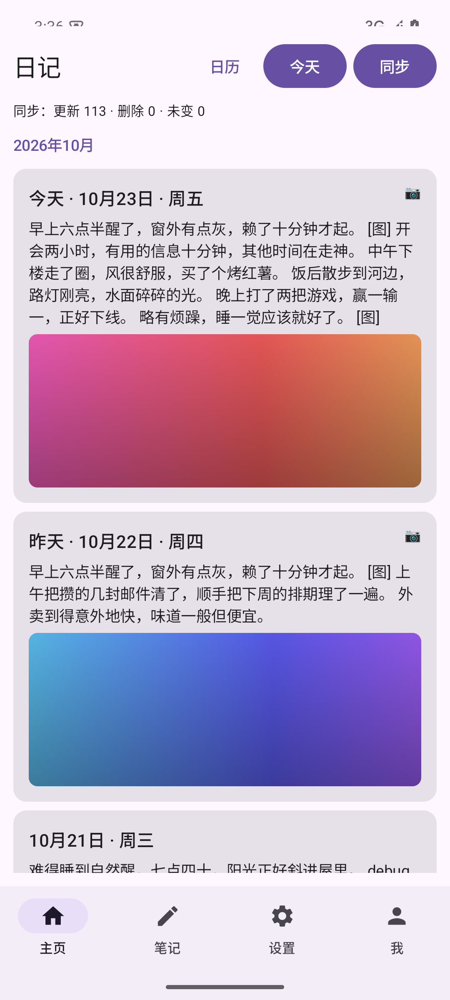
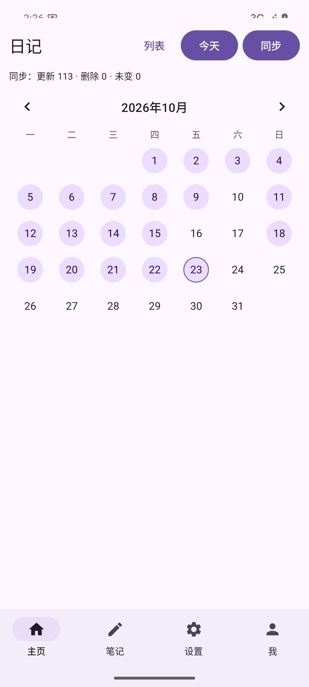
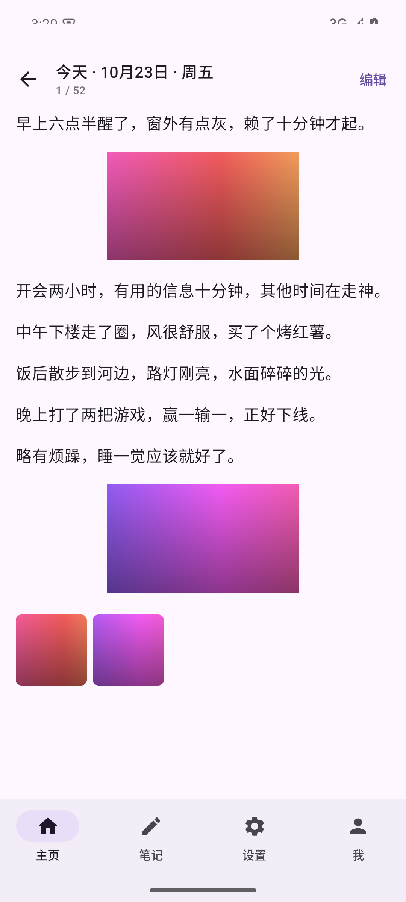
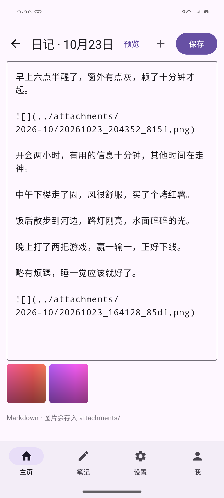
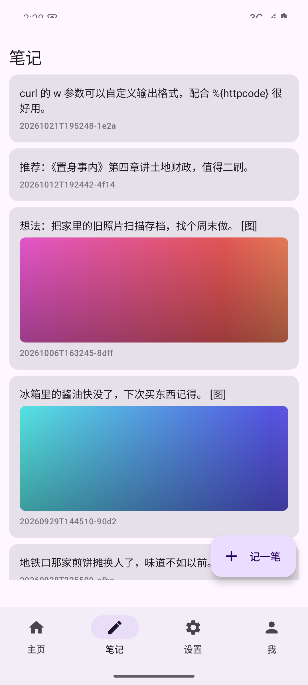
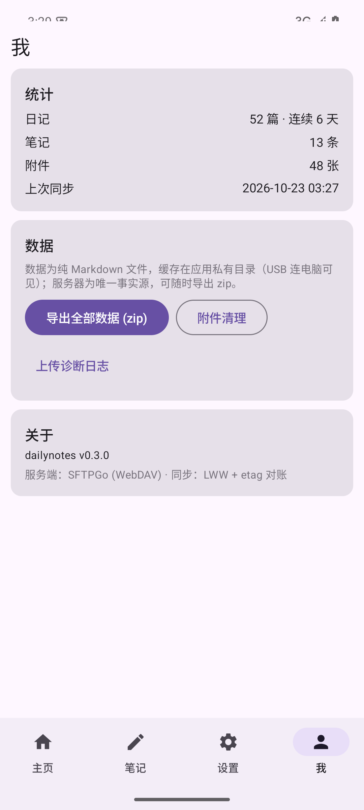
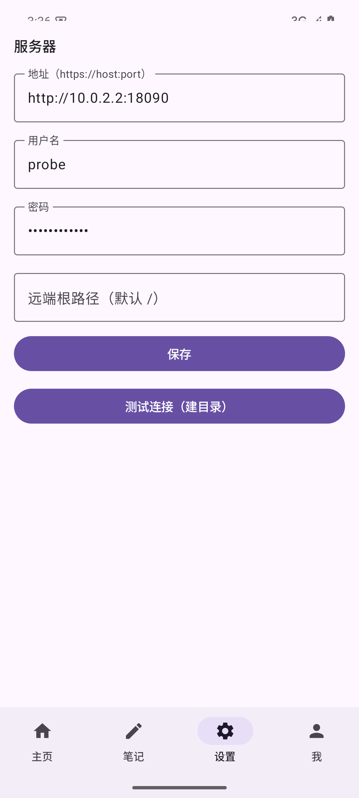
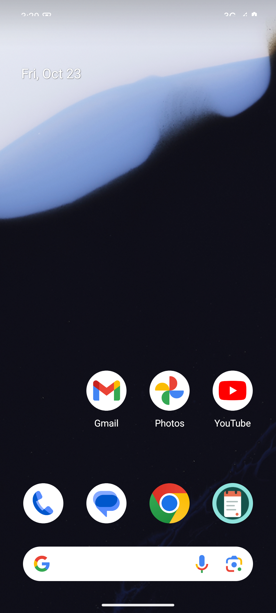

# dailynotes

**自托管的 Android 日记 + 速记应用：你的日记存在你自己的服务器上，是纯 Markdown 文件。**

Self-hosted diary & quick notes for Android. Your data lives on **your** server, as plain Markdown files.

---

## 给谁用

- 你想写日记 + 随手速记，主力设备是 Android 手机
- 你不想把日记交给任何云服务商（Day One 们订阅制 + 数据在人家手里）
- 你家里有一台能跑 Docker 的机器（NAS / 迷你主机 / 树莓派 / VPS 均可）

## 为什么不是 X

| 方案 | 不合适的地方 |
|---|---|
| Day One | 闭源 + 订阅，数据只能存它的云 |
| Memos | 单条信息流，没法按天翻看多年日记；无官方原生 App |
| Obsidian + 同步 | 本质是文件管理器，写日记要自己管文件；移动端同步要么付费要么折腾 |
| Notesnook / Joplin | 笔记优先的设计，不是日记优先；移动体验或自建成本各有痛点 |

dailynotes 的组合在开源世界里是空白：**按日聚合的日记流 + 卡片速记 + 自建 WebDAV 同步 + 纯 Markdown 零锁定**。

## 功能

- **主页**：日记信息流，每天一条（`diary/2026-10-23.md`），300 字预览 + 首图缩略；日历视图一眼看清断档，点空白日期可补记任意一天
- **阅读**：左右滑动切上/下一篇，连续翻看像翻旧日记本
- **编辑**：Markdown 编辑，点「编辑」直达编辑框；插图自动归档到 `attachments/` 按月分桶
- **笔记**：卡片速记流，FAB「记一笔」，长按删除——和日记共用一个系统但互不干扰
- **同步**：etag 对账增量同步，1500 篇全量拉取约 20 秒，日常保存秒级；断点续传（每 50 篇存档，中断重试不重头）
- **我**：统计（连续天数）/ 全量导出 zip / 附件清理（缩略图网格勾选）/ 一键上传诊断日志

## 界面预览

| 主页 · 日记信息流 | 日历 · 断档可视/补记任意一天 |
|---|---|
|  |  |

| 阅读 · 左右滑切上/下一篇 | 编辑 · Markdown + 插图 |
|---|---|
|  |  |

| 笔记 · 卡片速记 | 我 · 统计/导出/附件清理 |
|---|---|
|  |  |

| 设置 · 填你的服务器地址即可 | 桌面 |
|---|---|
|  |  |

截图为 API 35 模拟器连接真实自托管服务端（SFTPGo）的实拍数据。

## 快速开始

### 1. 起服务端（任意能跑 Docker 的 Linux）

```bash
git clone https://github.com/tomasWade/dailynotes && cd dailynotes/server
# 改 loaddata.json 里的 admin/用户密码，home_dir 指向数据卷内用户目录
docker compose up -d          # SFTPGo :8080(管理) :8090(WebDAV)
./probe.sh                    # 协议自检，应 7 项全 PASS
```

默认只绑 127.0.0.1。生产部署（公网 VPS + 域名 + HTTPS）前面加一层 Caddy 反代，见 `docs/app-design.md` §6.2；内网/ Tailscale 直连也完全可以（App 明文 HTTP 仅建议在内网隧道下使用）。

强烈建议配上每日快照（防手滑，保留 30 份）：

```bash
# crontab -e
0 4 * * * /path/to/server/backup.sh /path/to/data /path/to/snapshots 30
```

### 2. 装 App

从 [Releases](https://github.com/tomasWade/dailynotes/releases) 下载最新 APK，或用 [Obtainium](https://github.com/ImranR98/Obtainium) 添加本仓库自动跟踪更新。

App 内「设置」：填服务器地址（如 `http://192.168.1.27:18090`）、账号密码，保存，点「同步」——完成。历史数据导入用 `server/import.sh <目录>`，已有 Memos/其他工具的 Markdown 按文件名放成 `diary/YYYY-MM-DD.md` 即可。

## 数据安全承诺

**App 永远不会删除你的日记**：

- App 内不存在任何删除**日记**的入口或代码路径（删除按钮只存在于笔记编辑器和附件清理页）
- 本地日记被移除只有一种情形：同步时发现服务端已无此文件（你在服务端删除，或切换到了新服务器）→ 本地跟随
- 笔记/附件的删除只发生在你主动操作（长按删除、附件清理勾选）；编辑中途放弃时，仅存在于本机、从未上传的临时图片也会被清理，它们从未进入服务器
- 兜底：服务端 `backup.sh` 每日快照（30 份硬链接时间机器），误删可从快照直接拷回

**数据格式**：服务器上是纯 Markdown 文件与图片（SFTPGo 数据卷内 `diary/ notes/ attachments/`），任何工具可读；手机端为 App 私有缓存（USB 连电脑可见），全量 zip 随时可导出。卸载 App 清空本地不影响服务器数据。

## 开发

```bash
export ANDROID_HOME=$HOME/Android/Sdk
gradle :app:assembleDebug                 # app/build/outputs/apk/debug/app-debug.apk
gradle :sync:test :app:testDebugUnitTest  # JVM 测试（sync 测试需本地 sftpgo 容器在跑）
```

真机联调：`adb install` + `adb reverse tcp:18090 tcp:18090`，App 服务器填 `http://localhost:18090`。客户端-服务端联调方案与故障注入清单见 `docs/development-plan.md` §6。

设计文档 `docs/app-design.md` / 开发计划 `docs/development-plan.md`（含同步架构 B 档：服务器唯一事实源 + 本地全量缓存 + LWW + etag 对账 + 应用层乐观锁 + 断点续传的完整设计演化）。

## License

[MIT](LICENSE)
